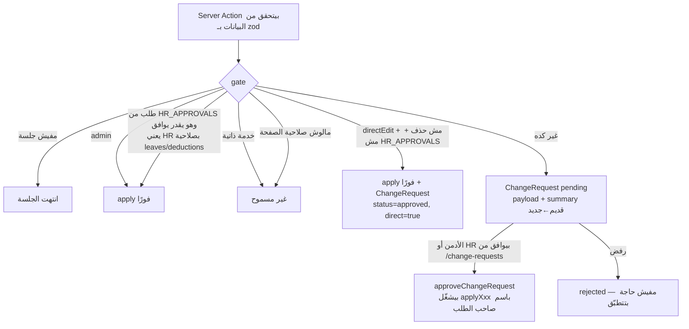
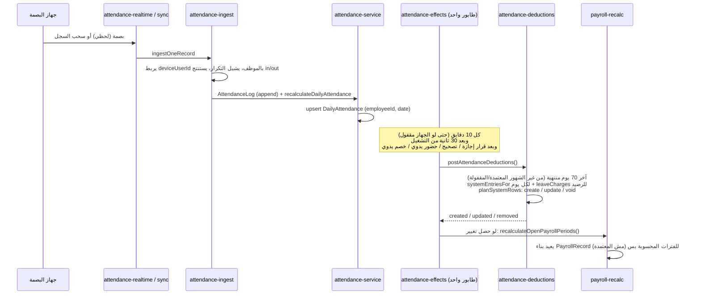

# Afro Egypt — Factory Workforce · شرح المشروع كامل (فرونت + باك)

> شرح تفصيلي للمشروع زي ما هو على فرع **`development`** (آخر تحديث: 2026-10-25، بعد إضافة تقرير القسم، وآخر commit قبله `4b59b15`).
> **مصدر الحقيقة هو الكود.** كل جزء هنا بيشاور على الملف اللي فيه التنفيذ، فلو حصل تعارض بين الوثيقة والكود، اللي في الكود هو الصح.
> الوثائق التانية في الريبو: `README.md` (التشغيل والنشر) · `PROJECT.md` (مرجع قديم، آخر تحديث له 2026-10-11) · `PLAN.md` / `PLAN-payroll-hr.md` (خطط المراحل) · `docs/DEMO-GUIDE.md` (سيناريو العرض).

---

## فهرس

1. [المشروع ده إيه؟](#1-المشروع-ده-إيه)
2. [التقنيات المستخدمة](#2-التقنيات-المستخدمة)
3. [هيكل الريبو](#3-هيكل-الريبو)
4. [المعمارية العامة: الطلب بيمشي إزاي](#4-المعمارية-العامة-الطلب-بيمشي-إزاي)
5. [الباك إند](#5-الباك-إند)
   - 5.1 قاعدة البيانات (Prisma / MySQL)
   - 5.2 المصادقة والجلسات
   - 5.3 الأدوار والصلاحيات والنطاق
   - 5.4 بوابة الموافقات `gate()` وطلبات التعديل
   - 5.5 سجل التدقيق
   - 5.6 طبقة القراءة (`getDb` / selectors)
   - 5.7 Server Actions (كل عمليات الكتابة)
   - 5.8 الـAPI Routes
   - 5.9 المحرّكات النقية (الحضور / الأجر / الرواتب / رصيد الإجازات)
   - 5.10 خط الخصومات والإضافي التلقائي وإعادة حساب الرواتب
   - 5.11 جهاز البصمة ZKTeco
   - 5.12 المستندات والإقرارات
   - 5.13 الإشعارات والتحديث اللحظي
   - 5.14 المساعد الذكي
6. [الفرونت إند](#6-الفرونت-إند)
   - 6.1 الـLayouts والـShell
   - 6.2 الصفحات صفحة صفحة
   - 6.3 المكوّنات (components)
   - 6.4 التدويل (عربي/إنجليزي)
   - 6.5 النماذج والـfeedback
   - 6.6 التحميل والـSkeletons والتصميم
7. [قواعد العمل (لائحة الشركة) بالتفصيل](#7-قواعد-العمل-لائحة-الشركة-بالتفصيل)
8. [سيناريوهات كاملة من أولها لآخرها](#8-سيناريوهات-كاملة-من-أولها-لآخرها)
9. [الاختبارات](#9-الاختبارات)
10. [التشغيل المحلي والنشر](#10-التشغيل-المحلي-والنشر)
11. [الفروع وسير العمل](#11-الفروع-وسير-العمل)
12. [قرارات مهمة وملاحظات مفتوحة](#12-قرارات-مهمة-وملاحظات-مفتوحة)
13. [قاموس مصطلحات](#13-قاموس-مصطلحات)

---

## 1. المشروع ده إيه؟

**Afro Egypt — Factory Workforce** نظام لإدارة العمالة والحضور والرواتب لمصنع أثاث في مصر (**Afro Egypt**)، من تطوير **404 Legends**. شغّال فعلًا في الإنتاج على سيرفر الشركة، ومش ديمو.

بيعمل الحاجات دي:

| المجال | بيعمل إيه |
|---|---|
| **الموظفين** | ملف كامل لكل موظف: بيانات شخصية، القسم، نوع الأجر، مواعيد العمل، مستندات التعيين، الإقرارات الموقّعة، والأرشفة |
| **الحضور** | بيستقبل البصمات من جهاز ZKTeco (لحظيًا، أو بالسحب، أو بالـpush) وبيحسب الحضور اليومي (حاضر/متأخر/غايب/بصمة ناقصة…) |
| **الإجازات** | طلبات إجازة وأعذار، اعتماد من HR أو الأدمن، **رصيد إجازة سنوية** محسوب تلقائيًا |
| **الإضافي والخصومات** | بيتحسبوا **تلقائيًا** من الحضور حسب لائحة الشركة، وكمان فيه إدخال يدوي (جزاءات، سلف، بدلات، مكافآت) |
| **الرواتب** | فترات رواتب (مسودة ← محسوبة ← معتمدة ← مقفولة)، كشف مرتب قابل للطباعة، وتصدير Excel |
| **الطلبات** | طلبات "سهر" أو أي طلب تاني للعمال، والأدمن أو HR بيوافقوا عليها |
| **الرقابة** | صلاحيات دقيقة لكل صفحة، نطاق أقسام لكل حساب، موافقات على التعديلات، وسجل تدقيق لكل تغيير حساس |
| **التقارير** | تقارير حضور/إضافي/خصومات/رواتب، تحليل تكلفة العمالة، وكشف إضافي شهري |

**اللغة:** الواجهة الأساسية عربي (RTL) وفيه إنجليزي، والتبديل بينهم لحظي. الأرقام دايمًا بالأرقام اللاتينية حتى في العربي (`ar-EG-u-nu-latn`).

---

## 2. التقنيات المستخدمة

| الطبقة | الأداة | الملاحظات |
|---|---|---|
| Framework | **Next.js 15** (App Router) | Server Components + Server Actions، `output: "standalone"` |
| اللغة | TypeScript 5 + React 18 | |
| قاعدة البيانات | **MySQL 8** عبر **Prisma 6** | السيرفر الحي شغّال على MariaDB |
| الستايل | Tailwind CSS 3 + `tailwindcss-animate` | خط **Cairo** من Google Fonts |
| مكوّنات الواجهة | **shadcn/ui** (فوق Radix UI) | الملفات في `src/components/ui` |
| الأيقونات | `lucide-react` | |
| الرسوم البيانية | `recharts` | في الداشبورد |
| الإشعارات المنبثقة | `sonner` | |
| النماذج | `react-hook-form` + `zod` 4 | Zod مستخدم كمان في التحقق على السيرفر |
| التواريخ | `date-fns` 4 | |
| المصادقة | `bcryptjs` + كوكي موقّع HMAC | مفيش NextAuth، المصادقة مكتوبة يدوي |
| جهاز البصمة | `node-zklib` | TCP مباشر لجهاز ZKTeco |
| الصور | `sharp` | صور مصغّرة webp |
| Excel | `xlsx` (SheetJS) | |
| الاختبارات | **Vitest** 3 | |
| المساعد الذكي | NVIDIA hosted models (API متوافق مع OpenAI) | اختياري |

**السكربتات (`package.json`):**

| الأمر | بيعمل إيه |
|---|---|
| `npm run dev` | سيرفر التطوير |
| `npm run build` / `npm start` | بناء الإنتاج وتشغيله |
| `npm run lint` | ESLint (`next lint`) |
| `npm test` / `npm run test:watch` | Vitest |
| `npm run db:migrate` | `prisma migrate dev` |
| `npm run db:deploy` | `prisma migrate deploy` |
| `npm run db:seed` | seed الإنتاج (`prisma/seed-prod.ts`) |
| `npm run db:seed:sample` | بيانات تجريبية كاملة (`prisma/seed-sample.ts`) |
| `npm run db:reset` / `db:studio` | reset للقاعدة / Prisma Studio |
| `postinstall` | `prisma generate` بيشتغل تلقائي بعد التثبيت |

---

## 3. هيكل الريبو

```
afro-egypt-workforce/
├── .github/workflows/deploy.yml   ← CI/CD: أي push على main بينشر على السيرفر الحي
├── Dockerfile                     ← بناء متعدد المراحل (standalone)
├── next.config.mjs                ← standalone + node-zklib كـ external package
├── tailwind.config.ts, postcss.config.mjs, components.json (shadcn)
├── vitest.config.mjs, tsconfig.json, .eslintrc.json
├── .env.example                   ← متغيرات البيئة كلها مشروحة
├── prisma/
│   ├── schema.prisma              ← نموذج البيانات كامل
│   ├── migrations/                ← 32 migration (من 2026-09-02 لـ 2026-10-24)
│   ├── seed-prod.ts               ← هيكل فاضي + أدمن واحد
│   └── seed-sample.ts             ← 50 موظف وهمي + ~13 يوم تاريخ + 4 حسابات
├── scripts/repair-failed-migration.mjs   ← بيصلّح migration معيّن لو علّق (بيتشغّل في الـCI)
├── public/brand/                  ← لوجو الشركة
├── storage/uploads/               ← (مش في git) مستندات الموظفين، برّه public عمدًا
├── src/
│   ├── middleware.ts              ← توجيه UX (مش أمان حقيقي)
│   ├── app/
│   │   ├── layout.tsx             ← الـroot layout: الخط، اللغة، الاتجاه، تشغيل مستمع الجهاز
│   │   ├── page.tsx               ← بيوجّه لـ /dashboard
│   │   ├── login/                 ← صفحة الدخول
│   │   ├── payslip/[recordId]/    ← كشف المرتب (برّه الـshell عشان الطباعة)
│   │   ├── (app)/                 ← كل الصفحات المحمية (layout بيفرض الجلسة)
│   │   └── api/                   ← punch · events · notifications · employees files · exports
│   ├── components/                ← ui (shadcn) · layout · shared · skeletons · مجلد لكل وحدة
│   ├── hooks/use-action-feedback.ts
│   └── lib/
│       ├── actions/               ← Server Actions (كل الكتابة) — 23 ملف
│       ├── assistant/             ← المساعد الذكي
│       ├── i18n/                  ← القاموس والترجمة
│       ├── *-engine.ts            ← محرّكات حساب نقية
│       └── … (خدمات، قراءة، صلاحيات، نطاق، تدقيق، جهاز…)
└── tests/                         ← 47 ملف Vitest
```

---

## 4. المعمارية العامة: الطلب بيمشي إزاي

### 4.1 الصورة الكبيرة

```mermaid
flowchart LR
  subgraph Browser
    UI[React Client Components<br/>forms · tables · dialogs]
    SSE[LiveRefresh<br/>EventSource /api/events]
  end
  subgraph "Next.js server (process واحد)"
    MW[middleware.ts<br/>توجيه UX]
    RSC[Server Components<br/>pages في app/(app)]
    SA[Server Actions<br/>src/lib/actions/*]
    API[API Routes<br/>src/app/api/*]
    ENG[محرّكات نقية<br/>attendance/pay/payroll/leave]
    RT[مستمع الجهاز اللحظي<br/>+ مزامنة كل 10 دقايق]
    BUS[(EventEmitter<br/>events.ts)]
  end
  DB[(MySQL / Prisma)]
  FS[(storage/uploads)]
  ZK[[جهاز ZKTeco<br/>TCP 4370]]
  NV[[NVIDIA API<br/>اختياري]]

  UI -->|navigation| MW --> RSC
  UI -->|form submit| SA
  RSC -->|getDb + scope| DB
  SA -->|gate + recordChange| DB
  SA --> ENG
  RSC --> ENG
  API --> DB
  API --> FS
  RT <--> ZK
  RT --> DB
  DB -. كل كتابة .-> BUS --> API --> SSE --> UI
  SA --> NV
```

### 4.2 المبادئ اللي المشروع مبني عليها

1. **المحرّكات النقية منفصلة عن الـI/O.** حساب الحضور والأجر والرواتب ورصيد الإجازات موجود في دوال نقية (`attendance-engine.ts`، `pay-engine.ts`، `pay-rules.ts`، `payroll-engine.ts`، `leave-balance.ts`) من غير قاعدة بيانات ولا ساعة، ومغطّاة باختبارات.
2. **قناة صلاحية واحدة للصفحات:** كل صفحة محمية بتنادي `requireAccess(path)` (`src/lib/auth.ts`)، اللي بتتحقق من توقيع الجلسة ومن صلاحية المسار. الـmiddleware بيعمل توجيه سريع للمستخدم بس، ومش هو اللي بيفرض الأمان.
3. **قناة كتابة واحدة:** أي كتابة ممكن يعملها حساب إداري بتعدّي على `gate()` (`src/lib/change-requests.ts`)، اللي بتقرّر هل التعديل يتنفّذ فورًا ولا يستنى موافقة.
4. **قناة تدقيق واحدة:** الدالة `recordChange` / `recordChangeAs` (`src/lib/audit.ts`) بتكتب التغيير وسطر التدقيق جوّا transaction واحدة، فيا الاتنين يتسجّلوا يا مفيش حاجة تتسجّل.
5. **القراءة مقصورة على نطاق المستخدم:** `Scope` (`src/lib/scope.ts`) بيتبعت كأول باراميتر إجباري لكل selector، فمستحيل حد ينسى يقصر القراءة.
6. **الفلوس أرقام صحيحة (`Int`) بالجنيه**، والمحرّكات بتقرّب لأقرب جنيه.
7. **`AttendanceLog` بيتكتب فيه بس (append-only)**: البصمة الخام عمرها ما بتتعدّل ولا تتمسح.
8. **الحذف ناعم (`deletedAt`)** على Employee / Department / Shift / PayType / WorkSchedule. الموظف نفسه مابيتمسحش، بيتأرشف.
9. **الحالة المشتركة على `globalThis`**: مستمع الجهاز، طابور المزامنة، وناقل الأحداث، لأن Next ممكن يجمّع نفس الموديول في أكتر من bundle.

---

## 5. الباك إند

### 5.1 قاعدة البيانات (`prisma/schema.prisma`)

#### الجداول الأساسية

| الجدول | الغرض | أهم الحقول |
|---|---|---|
| `User` | حسابات الدخول | `email` (فريد)، `passwordHash` (bcrypt)، `role`، `permissions` (JSON array)، `directEdit`، `departmentIds` (JSON)، `employeeId` (ربط بموظف)، `active`، `lastLoginAt` |
| `Department` | الأقسام | `name`، `managerId` (رئيس القسم = موظف حقيقي)، `deletedAt` |
| `DepartmentNumberSequence` | عدّاد أرقام الموظفين لكل كود قسم | `code` (PK)، `lastValue` |
| `Shift` | الوردية القديمة (لسه مطلوبة كـFK على الموظف والحضور) | `startTime`، `endTime`، `gracePeriodMinutes`، `workDays` |
| `Employee` | الموظف | شرحه تحت |
| `PayType` | نوع الأجر وقواعده (كلها قابلة للتعديل من `/settings`) | `basis` (monthly/daily)، `dayDivisor`، المضاعفات، قاعدة الخميس، جدول الغياب… |
| `WorkSchedule` | مواعيد العمل ("الورديات" في الواجهة) | `startTime`، `endTime`، `overtimeStart` |
| `Device` | أجهزة البصمة (للـpush) | `apiKeyHash` |
| `AttendanceLog` | **البصمات الخام** (append-only) | `employeeId`، `deviceUserId`، `timestamp`، `punchType` (in/out)، `source` (biometric/manual_correction/simulated)، `rawPayload` |
| `DailyAttendance` | الحضور المحسوب، صف واحد لكل موظف في اليوم | فريد `(employeeId, date)`، `actualIn/Out`، `lateMinutes`، `earlyLeaveMinutes`، `overtimeMinutes`، `status`، بيانات التصحيح |
| `Leave` | الإجازات والأعذار | `type`، `from/to`، `reason` (اختياري، بيتخزن `""`)، `status` |
| `Overtime` | الإضافات (إضافي، جمعة، إجازة رسمية، وقت الخميس) | `kind`، `hours`، `hourlyRate`، `amount`، `autoGenerated`، `systemKey` (فريد)، `originalHours/Amount`، `editedBy/At`، `voidedBy/At` |
| `Deduction` | الخصومات والجزاءات | `type`، `amount`، `reason`، `autoGenerated`، `systemKey`، `originalAmount`، `voidedAt` |
| `Allowance` | البدلات والمكافآت | `type`، `monthly` (متكرر) أو `effectiveYear/Month` (مكافأة لمرة واحدة) |
| `PayrollPeriod` | فترة رواتب | فريد `(year, month)`، `status`: draft → calculated → approved → closed |
| `PayrollRecord` | سطر راتب موظف في فترة | الأساسي، البدلات، الإضافي، الإجمالي، تفصيل الخصومات، الصافي، `paidDaysCount` و`dailyRateApplied` (لليومي) |
| `EmployeeDocument` | مستندات التعيين | `type` (enum)، `fileUrl` (مفتاح تخزين خاص)، `mimeType`، `uploadedBy` |
| `EmployeeAcknowledgment` | الإقرارات الموقّعة | فريد `(employeeId, key)`، `label` |
| `AssistantMessage` | محادثات المساعد الذكي لكل مستخدم | `role`، `content` |
| `AuditLogEntry` | سجل التدقيق | `userName`، `action`، `module`، `oldValue`، `newValue`، `reason`، `timestamp` |
| `ChangeRequest` | طلبات التعديل المعلّقة / المنفّذة مباشرة | `actionKey`، `payload` (JSON)، `summary`، `status`، `direct` |
| `Holiday` | الإجازات الرسمية | `name`، `from/to` (ممكن تكون أكتر من يوم زي العيد) |
| `WorkRequest` | طلبات "سهر" وغيرها (أحدث جدول، 2026-10-24) | `type` (late_work/other)، `date`، `fromTime/toTime`، `details`، `employeeIds` (JSON)، `status`، `decidedBy/At`، `decisionNote` |

**جداول الإعدادات** (كل واحد فيها صف واحد بـ `id = "singleton"`): `CompanySettings`، `AttendanceSettings` (منها `weeklyOffDays = "5"` يعني الجمعة)، `PayrollSettings` (منها `payPeriodStartDay = 26`)، و`BiometricDeviceSettings` (`ip`، `port = 4370`، `commPassword`).

#### الـEnums المهمة
- `Role`: `admin` · `hr` · `supervisor` · `employee` · `staff`
- `EmployeeStatus`: `active` · `on_leave` · `terminated`
- `SalaryType`: `monthly` · `daily`
- `AttendanceStatus`: `present` · `late` · `absent` · `leave` · `mission` · `excused_absence` · `early_leave` · `missing_punch`
- `LeaveType`: `annual` · `casual` · `sick` · `unpaid` · `mission` · `permission` · `excused_absence`
- `DeductionType`: `late` · `absence` · `early_leave` · `permission` · `unauthorized_exit` · `penalty` · `advance` · `admin_deduction` · `other`
- `AllowanceType`: `transport` · `meal` · `fixed` · `incentive` · `bonus`
- `EmployeeDocumentType`: 16 نوع (بطاقة، ميلاد، فيش، مؤهل، كعب عمل، CV، رخصة قيادة، تجنيد…)

#### جدول `Employee` بالتفصيل
- **`employeeNumber`**: فريد، بصيغة `<كود القسم>-<تسلسل>` زي `ACC-001`، وبيتولّد ذرّيًا من `DepartmentNumberSequence` بـ `INSERT … ON DUPLICATE KEY UPDATE … LAST_INSERT_ID()` (`src/lib/employee-number.ts`). ده الرقم اللي بيظهر في الواجهة والـURL (`/employees/ACC-001`)، والـ`id` الداخلي مابيظهرش أبدًا.
  - **لو الموظف اتنقل لقسم تاني بياخد رقم جديد** من تسلسل القسم الجديد، في نفس الـtransaction بتاعة التعديل. الأرقام اللي اتسابت مابتترجعش تاني أبدًا.
  - أكواد الأقسام في `src/lib/department-codes.ts` (`الإنتاج → PROD`، `الحسابات → ACC`، `غير محدد → TBD`…).
- **الأجر:** `payTypeId`، `salaryType`، `basicSalary` (الراتب الشهري كامل)، `dailyRate` (أجر اليوم لليومي)، `dailyWorkingHours`، و`overtimeEligible` (مفتاح "له إضافي").
- **مواعيد العمل:** `workScheduleId` أو أوقات مخصّصة (`customWorkStart/End/OvertimeStart`).
- **الجهاز:** `biometricDeviceUserId` (فريد) و`biometricLinkedAt`.
- **الحالة:** `status`، `terminatedAt`، `archivedAt`.
- **بيانات شخصية:** `nationalId` (فريد)، `phone`، `address`، `qualification`، `militaryStatus`، `gender`، `isDriver`. كلها nullable في القاعدة عشان الـmigration تعدّي على الصفوف القديمة، والفورم هو اللي بيفرضها.
- **المطلوبات:** `requiredDocuments` و`requiredAcknowledgments` (لو `null` يبقى الموظف ماشي على القايمة الافتراضية المحسوبة).

#### الـMigrations
33 فولدر (32 migration + `migration_lock.toml`). أي migration فيها تغيير ممكن يبوّظ بيانات موجودة بتتكتب يدوي على خطوات (مثال: `employee_number_step1_add_nullable` بعدها `step2_lock_not_null_unique`). آخر واحدة `20261024085608_work_requests` (`CREATE TABLE` بس).

---

### 5.2 المصادقة والجلسات

| الملف | الدور |
|---|---|
| `src/lib/session.ts` | `encodeSession` / `decodeSession`: الكوكي شكله `base64url(json).base64url(HMAC-SHA256)` بالمفتاح `SESSION_SECRET` (لازم ≥16 حرف وإلا التطبيق يرمي خطأ). المقارنة بـ `timingSafeEqual`. البيانات **موقّعة بس مش مشفّرة**، فمينفعش يتحط فيها أسرار. |
| `src/lib/auth.ts` | `getSession()` · `requireSession()` (لو مفيش جلسة يحوّل لـ `/login`) · **`requireAccess(path)`** (الجلسة + `canAccess`، ولو مش مسموح يحوّل لـ `/dashboard`) · `setSessionCookie` (httpOnly، `sameSite=lax`، و`secure` في الإنتاج إلا لو `SECURE_COOKIES=false`، ومدتها 8 ساعات) |
| `src/lib/actions/auth.ts` | `loginAction` (bcrypt، بيتأكد إن الحساب `active`، وبيحدّث `lastLoginAt`) و`logoutAction` |
| `src/middleware.ts` | بيقرا الكوكي **من غير ما يتحقق من التوقيع**، وده للتوجيه بس: اللي مش مسجّل يروح `/login`، واللي مسجّل وفتح `/login` يروح `/dashboard`، والمسار الممنوع يروح `/dashboard`. الـmiddleware مابيشتغلش على `/api` ولا الملفات الثابتة. |

> **مهم:** الأمان الحقيقي في `requireAccess` جوّا كل صفحة وفي فحوصات كل action/route، مش في الـmiddleware.

---

### 5.3 الأدوار والصلاحيات والنطاق

#### الأدوار
- **`admin`**: يقدر يعمل كل حاجة، وهو الوحيد اللي بيدير المستخدمين والصلاحيات وبيوافق على طلبات التعديل العامة.
- **`employee`**: خدمة ذاتية. بيشوف بياناته بس (الداشبورد، حضوره، إجازاته، كشف مرتبه) ويقدر يقدّم طلب إجازة لنفسه.
- **`hr` / `supervisor` / `staff`** (اسمهم "اداري" في الواجهة): صلاحياتهم بتتحدّد بقايمة يحطها الأدمن واحدة واحدة.
  - **الحساب اللي مالوش ولا صلاحية بيتعامل كخدمة ذاتية** (`isSelfService`)، زي الموظف بالظبط.
  - **النطاق:** `departmentIds`. لو فاضية يبقى شايف الشركة كلها، ولو فيها أقسام يبقى شايف موظفين الأقسام دي بس.

#### الصلاحيات القابلة للمنح (`PERMISSION_DEFS` في `src/lib/permissions.ts`)

| المفتاح | الصفحة |
|---|---|
| `employees` | `/employees` |
| `departments` | `/departments` |
| `shifts` | `/shifts` |
| `attendance` | `/attendance` |
| `leaves` | `/leaves` |
| `overtime` | `/overtime` (ومعاها `/overtime/statement`) |
| `deductions` | `/deductions` (ومعاها البدلات) |
| `payroll` | `/payroll` |
| `reports` | `/reports` |
| `workforce_cost` | `/workforce-cost` |
| `audit_log` | `/audit-log` |
| `settings` | `/settings` |
| `biometric_device` | `/biometric-device` |
| `requests` | `/requests` |

**الصفحات اللي ماينفعش تتمنح لحد (للأدمن بس):** `/users` و`/permissions` و`/change-requests`. الاستثناء الوحيد إن HR اللي بيوافق على الإجازات أو الخصومات بيفتح `/change-requests`، وبيشوف فيها **الطلبات دي بس**.

#### الدوال المساعدة

| الدالة | بترجع إيه |
|---|---|
| `isSelfService(user)` | الموظف، أو الإداري اللي مالوش صلاحيات |
| `hasPermission(user, key)` | الأدمن دايمًا `true`، والخدمة الذاتية دايمًا `false` |
| `allowedNavPaths(user)` | الروابط اللي تظهر في القايمة الجانبية |
| `canAccess(user, path)` | هل المسار (أو أي مسار تحته) مسموح |
| `actionPermission(actionKey)` | الصلاحية المطلوبة لأي كتابة حسب أول جزء من مفتاحها (`employees.update` محتاجة `employees`، و`allowances.*` محتاجة `deductions`، و`biometric.*` محتاجة `biometric_device`) |
| `HR_APPROVALS` | `leaves.decide` ← `leaves`، و`deductions.create` ← `deductions` |
| `canApprove(user, perm)` | الأدمن، أو حساب دوره `hr` ومعاه الصلاحية دي |
| `canReviewRequest` / `reviewsRequests` | مين يراجع أي نوع طلب |
| `canManageEmployeeFiles` | الأدمن، أو `hr` ومعاه `employees`. المشرف **ماينفعش** حتى لو معاه الصلاحية |
| `canUseAssistant` | محتاج صلاحية `employees` |
| `canUseBiometricDevice` | محتاج صلاحية `biometric_device` |

#### النطاق (`src/lib/scope.ts`)
```ts
type Scope = { all: true } | { all: false; ids: ReadonlySet<string> };
```
- `viewerScope(user, employees)`: الأدمن شايف الكل. الخدمة الذاتية شايفة نفسها بس. الإداري شايف الكل لو `departmentIds` فاضية، وإلا موظفين أقسامه بس.
- `inScope` · `employeesInScope` · `rowsInScope` · `scopedSnapshot` (بيقصر كل جداول الـStore مرة واحدة).
- `canViewEmployee(user, id)`: نفس القاعدة لموظف واحد من غير ما يحمّل كل الموظفين، ومستخدمة في الـAPI routes والـactions.
- `canLinkDeviceEmployee`: صلاحية الجهاز + الموظف يكون جوّا النطاق.
- **صفحة موظف خارج النطاق بترجع 404.**

---

### 5.4 بوابة الموافقات `gate()` وطلبات التعديل

`src/lib/change-requests.ts` هي **نقطة العبور الوحيدة** لأي كتابة ممكن يعملها حساب إداري:



- كل action مقسومة لجزئين: `createX(prev, formData)` بتتحقق وتنادي `gate`، و`applyCreateX(payload, actorName)` اللي بتكتب فعلًا. الجزء التاني بيعيد الفحوصات تاني، لأن الموافقة ممكن تيجي بعد ما الدنيا اتغيّرت.
- **الحذف دايمًا محتاج موافقة**، حتى لو الحساب معاه `directEdit`.
- **قرار الإجازة وإضافة خصم** مايوافقش عليهم غير الأدمن أو HR (اللي معاه الصلاحية دي). حتى `directEdit` مابيعدّيهمش. المشرف يقدر يقدّم الطلب بس مايقدرش يقرّر.
- `src/lib/actions/change-requests.ts`: فيها `approveChangeRequest` (بتختار دالة الـapply المناسبة حسب `actionKey`) و`rejectChangeRequest`.
- `src/lib/i18n/payload-labels.ts`: بتحوّل الـpayload لنص مفهوم في شاشة المراجعة.

---

### 5.5 سجل التدقيق (`src/lib/audit.ts`)

- `recordChange(entry, write)`: بتجيب اسم المستخدم من الجلسة، وتنفّذ `write(tx)` وتكتب صف في `AuditLogEntry` جوّا `prisma.$transaction` واحدة.
- `recordChangeAs(name, entry, write)`: نفس الفكرة بس من غير جلسة، ومستخدمة في تطبيق الموافقات (باسم صاحب الطلب) وفي المهام الخلفية (باسم "النظام").
- `writeAudit(tx, …)`: بتكتب صف تدقيق جوّا transaction شغّالة أصلًا.
- صفحة `/audit-log` بتعرض آخر 200 صف.

---

### 5.6 طبقة القراءة

| الملف | الدور |
|---|---|
| `src/lib/prisma.ts` | PrismaClient متغلّف بـ extension: **أي عملية كتابة** (create/update/delete…) بتنادي `notifyDataChanged()` عشان يحصل تحديث لحظي. وفيه نوع `TransactionClient` |
| `src/lib/data.ts` | `getDb()`: بيحمّل **snapshot كامل** للجداول الأساسية بشكل `Store` مرة لكل request. ده قرار مقصود عشان البساطة، والحجم الحالي مستحمله. الجداول الكبيرة اللي بيتكتب فيها بس (`AttendanceLog` و`AuditLogEntry`) مش داخلة فيه |
| `src/lib/store.ts` / `types.ts` | أنواع الـStore والكيانات بالشكل اللي بيتبعت للواجهة |
| `src/lib/serialize.ts` | بيحوّل صفوف Prisma لأنواع الواجهة (التواريخ تبقى ISO، و`dayStr` بترجع `yyyy-MM-dd`) |
| `src/lib/selectors.ts` | read models للداشبورد والتقارير، **وأول باراميتر فيها `Scope`**. وفيه `departmentWorkforceCost` (تكلفة قسم واحد)، ودي القاعدة الوحيدة لحساب التكلفة، وبيستخدمها `/workforce-cost` وتقرير القسم |
| `src/lib/department-report.ts` | **تقرير القسم:** `departmentReport(scope, user, departmentId, range, locale)` بيرجّع `null` (يعني 404) لو القسم مش موجود أو محذوف أو برّه أقسام الحساب. والدالة النقية `buildDepartmentReport` بتعيد استخدام `attendanceSummary`، وصفوف الغياب المسجّلة، و`annualLeaveBalance`/`requestDays`، و`buildOvertimeStatement`، و`departmentWorkforceCost`، وقاعدة "أوراق ناقصة". وكل قسم في التقرير بيظهر حسب صلاحيته (`reportSections`). الصفحة والتصدير بيستخدموه الاتنين |
| `src/lib/department-report-range.ts` | فترات التقرير (`week` · `current` · `previous`) و`reportRangeDates`، وده ملف آمن يتستورد في الـclient |
| `src/lib/department-report-export.ts` | `buildDepartmentReportWorkbook`: دالة نقية بتبني ملف Excel للتقرير، شيت لكل قسم مسموح، بلغة الواجهة، وRTL في العربي |
| `src/lib/pay-context.ts` | `loadPayContext()`: بيحمّل أنواع الأجر وجداول الدوام والإجازات الرسمية والإعدادات. وفيه `rulesFor` و`scheduleFor` و`kindOf` و`effectiveShift` |
| `src/lib/work-schedules.ts` | `loadScheduleRows()`: قايمة مواعيد العمل مع الموظفين اللي عليها (`/shifts` و`/settings` بيقروا نفس القايمة) |
| `src/lib/entry-context.ts` | بيضيف لكل صف إضافي/خصم القسم ونوع الأجر وحضور اليوم ده، عشان ديالوج التفاصيل |
| `src/lib/day-pay-view.ts` | عرض "أجر اليوم" في ملف الموظف |
| `src/lib/leave-days.ts` | بيقرا الإجازة الأسبوعية والإجازات الرسمية ويرجّع `kindOf` لرصيد الإجازات. وفيه `loadBalanceInputs` |
| `src/lib/overtime-statement-data.ts` | بيانات كشف الإضافي مقصورة على نطاق المستخدم |

---

### 5.7 Server Actions (`src/lib/actions/*`): كل عمليات الكتابة

كل action بيرجّع `ActionState = { success?, error?, message?, fields? }` (`src/hooks/use-action-feedback.ts`).

| الملف | الدوال | ملاحظات |
|---|---|---|
| `auth.ts` | `loginAction` · `logoutAction` | |
| `employees.ts` | `createEmployee` · `updateEmployee` · `archiveEmployee` · `unarchiveEmployee` | **مفيش حذف موظف، فيه أرشفة بس.** تغيير القسم بيدّي رقم جديد. لو الحالة اتغيّرت لـ`terminated` بيقفل حساب الدخول المرتبط (`active=false`) **ويفك ربط جهاز البصمة** في نفس الـtransaction. تعديل الأدمن بيتاخد زي ما اتكتب من غير فرض للفورمات |
| `departments.ts` | create / update / delete | رئيس القسم لازم يكون موظف |
| `shifts.ts` | `createShift` · `updateShift` | الورديات القديمة |
| `pay-settings.ts` | `savePayType` · `updatePayTypeRule` · `deletePayType` · `saveWorkSchedule` · `deleteWorkSchedule` · `saveGeneralPaySettings` | أي تغيير بيشغّل `refreshPayCalculations()` في الخلفية. حذف مواعيد عمل عليها موظفين بيترفض ويقول أساميهم |
| `holidays.ts` | `addHoliday` · `deleteHoliday` | |
| `settings.ts` | `updateCompanySettings` · `updateAttendanceSettings` · `updatePayrollSettings` | |
| `attendance.ts` | `correctAttendance` · `addManualAttendance` | الحضور اليدوي بيضيف بصمتين (`manual_correction`) ويمشي في **نفس** خط الحساب. وبعدها `scheduleAttendanceEffects()` |
| `leaves.ts` | `createLeave` · `decideLeave` · `deleteLeave` | الإجازة السنوية بتتحقق من الرصيد. القرار بيعيد حساب الأيام وبيشغّل الخصومات. الحذف للأدمن بس ومن غير `gate` |
| `overtime.ts` | `createOvertime` · `decideOvertime` · `updateOvertime` · `deleteOvertime` | الإدخال اليدوي محتاج صلاحية `overtime` والموظف يكون `overtimeEligible`، **حتى للأدمن**. التعديل بيحتفظ بالقيم الأصلية. حذف صف النظام بيعلّمه `voidedAt` |
| `deductions.ts` | `createDeduction` · `updateDeduction` · `deleteDeduction` | الموظف لازم يكون جوّا النطاق. بعد أي تغيير بيعيد حساب الرواتب المحسوبة (`payrollChanged`) |
| `allowances.ts` | `createAllowance` · `deleteAllowance` | المكافأة مربوطة بشهرها |
| `payroll.ts` | `openPayrollPeriod` · `calculatePayroll` · `approvePayrollPeriod` · `closePayrollPeriod` | الحساب نفسه في `payroll-recalc.ts` |
| `work-requests.ts` | `createWorkRequest` · `decideWorkRequest` | سجل بس، مابيأثّرش على الحضور ولا الأجر. القرار محمي من السباق بـ `updateMany where status=pending` |
| `users.ts` | `createUser` · `updateUser` · `deleteUser` · `resetUserPassword` | للأدمن بس. الأدمن مايقدرش يقفل حسابه على نفسه |
| `permissions.ts` | `updateUserPermissions` | الصلاحيات و`directEdit` و`departmentIds` |
| `change-requests.ts` | `approveChangeRequest` · `rejectChangeRequest` | |
| `biometric-device.ts` | اختبار الاتصال، تحديث الإعدادات، حذف مستخدم/بصمة من الجهاز، تسجيل بصمة، إعادة تشغيل، تفعيل/تعطيل، تعديل الاسم، **ربط/فك ربط موظف**، مسح سجل الجهاز، حالة الاتصال اللحظي، مزامنة يدوية، إيقاف/استئناف | الربط بيعمل backfill للتاريخ |
| `device-users.ts` | `getDeviceUserNamesAction` | أسماء مستخدمي الجهاز لقايمة الموظفين، وبتتجاب بعد ما الصفحة تظهر |
| `employee-documents.ts` / `employee-acknowledgments.ts` | `setDocumentRequired` / `setAcknowledgmentRequired` | تخصيص قايمة المطلوب لموظف معيّن |
| `assistant.ts` | `sendAssistantMessage` · `loadAssistantHistory` · `clearAssistantHistory` | |
| `locale.ts` | `setLocale` | كوكي اللغة |

---

### 5.8 الـAPI Routes (`src/app/api`)

الـmiddleware مابيشتغلش على `/api`، فكل route بيتحقق من الجلسة والصلاحية بنفسه.

| Route | Method | الوظيفة | الحماية |
|---|---|---|---|
| `/api/punch` | POST | استقبال بصمة من جهاز (push). Body فيه: `{deviceUserId, timestamp?, punchType?, deviceId?}`. لو `punchType` مش موجود بيستنتجه | هيدر `X-Punch-Key` = `PUNCH_API_KEY` |
| `/api/events` | GET | **SSE**: بيبعت `data: changed` عند أي كتابة و`ping` كل 25 ثانية | الجلسة |
| `/api/notifications` | GET | بيانات جرس الإشعارات | الجلسة |
| `/api/employees/[id]/documents` | GET / POST / DELETE | عرض المستند (`?docId=`، وفيه `?thumb=1` لصورة مصغّرة 96×96 webp)، ورفع (multipart: `file` و`type`)، وحذف | الجلسة + `canViewEmployee` للعرض، و`canManageEmployeeFiles` للرفع والحذف. المسار الفعلي للملف بيتقري من القاعدة |
| `/api/employees/[id]/acknowledgments` | GET / POST / DELETE | نفس الكلام للإقرارات (`?key=`، و`key=new` مع `label` لخانة مخصّصة) | نفس الحماية |
| `/api/payroll/export` | GET `?period=` | ملف **"تفاصيل المرتبات"** xlsx (`payroll-details-YYYY-MM.xlsx`) | `requireAccess("/payroll")` + صلاحية `payroll` + النطاق |
| `/api/overtime/statement/export` | GET `?month=&from=&to=` | ملف **"كشف الإضافي"** xlsx | صلاحية `overtime` + النطاق. لو مفيش بيانات مابيطلعش ملف |
| `/api/departments/[id]/report/export` | GET `?range=week\|current\|previous` | ملف **تقرير القسم** xlsx (`department-report-<CODE>-<from>_<to>.xlsx`)، شيت لكل قسم في التقرير المستخدم معاه صلاحيته | الجلسة (401)، وصلاحية `departments` (403)، والقسم موجود ومش محذوف وجوّا أقسام الحساب (404). ولو مفيش موظفين في النطاق يرجّع 404 |

---

### 5.9 المحرّكات النقية

#### أ. محرّك الحضور (`src/lib/attendance-engine.ts`)
- `getShiftWindow` و`shiftDaysForPunch`: بيحدّدوا البصمة تبع أنهي يوم وردية، جوّا **نافذة ±6 ساعات** (`PUNCH_WINDOW_MS`)، وبيدعموا الوردية اللي بتعدّي نص الليل.
- `computeDailyAttendance` / `computeFromActuals`: أول بصمة دخول وآخر بصمة خروج، وبعدها يحسب التأخير بعد فترة السماح، والانصراف المبكر، والإضافي، والحالة.
- الحالات: `present` · `late` · `early_leave` · `missing_punch` (بصمة واحدة) · `leave` · `mission` · `excused_absence` · `absent`.
- `withOpenShift`: لو الموظف عامل بصمة واحدة ولسه ورديته ماخلصتش (+4 ساعات سماح) بيتعرض **حاضر** مش "بصمة ناقصة".
- **الغياب:** `absenceCandidates` بيشتغل بس على الموظف اللي ليه بصمة مربوطة، و**من `ABSENCE_TRACKING_FROM = 2026-09-21`** ومن تاريخ الربط، ومن غير الجمعة والإجازات الرسمية (`isWorkday`).
- `attendanceSummary` و`matchesAttendanceStatusFilter` للفلاتر.

#### ب. محرّك الأجر اليومي (`src/lib/pay-engine.ts`)
**مفيش ولا رقم ثابت في الكود**، كل القواعد جاية من `PayTypeRules` (صف في جدول `PayType`).
- `resolveSchedule`: ترتيب أولوية مواعيد الموظف هو **الأوقات المخصّصة ← جدول الدوام (WorkSchedule) ← أوقات نوع الأجر ← الوردية القديمة**.
- `dayTimes`: بيطبّق **قاعدة الخميس** (اليوم يخلص بدري، والوقت لحد بداية الإضافي يتحسب "وقت الخميس").
- `dayRate`: لليومي بيرجّع `dailyRate`، وغير كده `basicSalary / dayDivisor`. و`hourlyRate` = أجر اليوم ÷ ساعات اليوم.
- `countedOvertimeMinutes`: حد أدنى (60 دقيقة) وبعدين خطوات (30 دقيقة).
- **`computeDayPay`** بيرجّع بنود اليوم:
  - **يوم إجازة أسبوعية أو رسمية:** كل ساعة شغل بتتحسب بالمضاعف (`friday` / `holiday`)، ومفيش أي خصم.
  - **يوم عمل:** `late` (دقائق بعد السماح × `lateMultiplier`)، `permission` أو `unauthorized_exit` (الوقت اللي فاته في آخر اليوم)، `thursday_extra`، و`overtime`.
  - **"له إضافي" مقفول:** مفيش أي إضافة (لا إضافي ولا جمعة ولا إجازة رسمية ولا خميس)، لكن التأخير والانصراف المبكر بيتخصموا عادي. ولو الخانة اتقفلت لموظف كان ليه إضافي قبل كده، الصفوف القديمة بتتشال بأثر رجعي (§5.10).
  - **بصمة واحدة:** مابيتحسبش ليها لا أجر ولا خصم، لحد ما HR يراجعها.
- `absenceDaysCharged`: المأمورية والإذن القصير ببلاش. الإجازة المعتمدة اللي اتطلبت قبلها بـ `leaveNoticeHours` (48 ساعة) تتخصم `permittedAbsenceDays` (يوم). وأي غياب تاني يتخصم `unpermittedAbsenceDays` (يومين).
- `dayKind`: بيحدّد اليوم إجازة رسمية ولا إجازة أسبوعية ولا يوم عمل.

#### ج. قواعد فترة الأجر (`src/lib/pay-rules.ts`)
- `payPeriodRange(year, month, startDay)`: لو البداية 26، يبقى شهر "أكتوبر" من 26 سبتمبر لـ 25 أكتوبر. ولو البداية 1 يبقى شهر تقويمي عادي.
- `payPeriodOf(day)`: اليوم ده تبع أنهي شهر محاسبي.
- `payday`: يوم الصرف هو أول الشهر اللي بعده.
- `dailyPaidDays`: الأيام اللي بيتدفع فيها لليومي هي أيام الشغل (`present/late/early_leave/missing_punch/mission`)، ومعاها (من تاريخ بدء تتبّع الغياب) أيام الغياب والإجازة والعذر، لأنها بتتحمّل عن طريق خصم الغياب، فمش هتتخصم مرتين. الجمعة والإجازة الرسمية مش يوم مدفوع لليومي، والشغل فيهم بيتحسب بالساعة.

#### د. محرّك الرواتب (`src/lib/payroll-engine.ts`)
```
الأساسي  = شهري: basicSalary   |   يومي: paidDays × dayRate
الإجمالي = الأساسي + البدلات + الإضافي المعتمد + الحوافز + المكافآت
الخصومات = late + absence + (early_leave + permission + unauthorized_exit) + penalty + advance + (admin_deduction + other)
الصافي   = الإجمالي − الخصومات
```
كل الخصومات جاية من جدول `Deduction`، فاللي ظاهر في صفحة الخصومات هو بالظبط اللي بيتخصم في كشف المرتب.

> **العرض:** في كشف المرتب و`/payroll` الإضافي بيظهر **في سطر لوحده بعد الإجمالي** (الإجمالي المعروض = gross − overtime)، وده تغيير في العرض بس، والصافي هو هو.

#### هـ. رصيد الإجازة السنوية (`src/lib/leave-balance.ts`)
- نقي، **ومفيش رصيد متخزّن**. بيتحسب في كل قراءة من تاريخ التعيين والإجازات وأيام الغياب.
- الحساب بـ **ربع يوم** كوحدة صحيحة (`UNITS_PER_DAY = 4`، والاستحقاق الشهري `7` وحدات يعني 1.75 يوم)، عشان 12 شهر يطلعوا 21 يوم بالظبط من غير أخطاء كسور.
- الاستحقاق بيبدأ بعد **6 شهور** من التعيين، وبيزيد 1.75 يوم أول كل شهر، و**بيتصفّر أول يناير**.
- **أي يوم غياب** (غياب من غير إجازة، أو إجازة معتمدة سنوية/عارضة/مرضي/بدون أجر/عذر) بياخد يوم كامل من الرصيد الأول، الأقدم فالأقدم. ولما الرصيد يخلص، اليوم بيتخصم من الأجر بجدول الغياب.
- الجمعة اللي **في نص** الإجازة بتتحسب (من الخميس للسبت = 3 أيام)، أما الجمعة اللي على طرف الإجازة والإجازات الرسمية فمابيتحسبوش.
- `checkAnnualLeaveRequest` بيرفض الطلب في الحالات دي: أيام مش صحيحة، أو الفترة كلها إجازات، أو الموظف لسه ماكمّلش 6 شهور، أو الإجازة بتعدّي سنة، أو الطلب جه قبل الإجازة بأقل من 48 ساعة. **أما لو الطلب أكبر من الرصيد فبيتقبل**، والرسالة بتوضّح كام يوم من الرصيد وكام من الأجر.

#### و. الأرشفة وترتيب القوائم (`src/lib/employee-order.ts`)
- `terminatedLast`: اللي انتهت خدمتهم بيتحطوا في آخر القوائم.
- `isArchived`: لازم الموظف يكون `terminated`، وكمان يا اتأرشف يدوي (`archivedAt`) يا عدّى **30 يوم** من `terminatedAt`. ده بيتحسب وقت القراءة، فمش محتاج أي job.
- `canArchive` و`deviceLinkClearOnTermination`.

#### ز. كشف الإضافي (`src/lib/overtime-statement.ts`)
- الفترة الافتراضية من **21 الشهر اللي فات لـ 20 الشهر ده** (`OVERTIME_PAYDAY = 20`).
- بيقسم الإضافي لأنواع: `overtime` · `friday` · `holiday` · `thursday_extra` · `manual`. وبيحسب المعتمد بس، والمحذوف (voided) مش داخل.

---

### 5.10 خط الخصومات والإضافي التلقائي وإعادة حساب الرواتب

ده أهم خط شغل في الباك إند:



**تفاصيل مهمة:**
- كل صف بيعمله النظام ليه **`systemKey = employeeId|date|type`** (فريد)، ده اللي بيضمن إن نفس الصف مايتكتبش مرتين.
- **لو صف النظام اتعدّل يدوي**، النظام بيسيبه زي ما هو وماعادش يحسبه تاني. والقيمة الأصلية بتفضل محفوظة في `originalAmount` / `originalHours`.
- **لو صف النظام اتحذف**، بيتعلّم `voidedAt` بدل ما يتمسح، عشان النظام مايرجعش يكتبه تاني.
- **قفل "له إضافي" بيسري بأثر رجعي** (`applyOvertimeEligibility` في `actions/employees.ts`، والقرار في الدالتين النقيتين `ineligibleOvertimeVoids` / `eligibleOvertimeRestores` في `attendance-deductions.ts`): جوّا نفس transaction تعديل الموظف، **كل** إضافات الموظف في الأيام المفتوحة بتتعمل void (`voidedBy = "النظام — له إضافي مقفول"`)، بأي نوع، تلقائي أو يدوي، معدّل أو لأ، معتمد أو معلّق، والقيم الأصلية بتفضل زي ما هي. وبيتكتب سطر تدقيق فيه العدد والمبلغ، وبعدها `scheduleAttendanceEffects({ payrollChanged: true })` عشان الرواتب المحسوبة تتعاد. الأيام اللي تبع شهر معتمد أو مقفول مابتتلمسش. ولو التعديل جه عن طريق طلب معلّق، ده بيحصل وقت الموافقة بس.
- **فتح "له إضافي" تاني:** الصفوف **التلقائية** اللي اتشالت بسبب قفل الخانة (في الأيام المفتوحة) بيتشال منها الـvoid وعلامة التعديل، فخط الترحيل العادي يرجع يحسبها. أما الصفوف اليدوية، واللي اتشال بإيد حد، فمابترجعش.
- أسباب الخصم بتتكتب **بالعربي وفيها المعادلة**، مثلًا: `تأخير 9.83 دقيقة × 1.5 = 14.75 دقيقة خصم`. القايمة بتعرض أول كلمة بس (`deduction-reason.ts`)، والنص كامل بيظهر في ديالوج التفاصيل.
- `lockedDayCheck`: أي يوم تبع شهر محاسبي **معتمد أو مقفول** مابيتلمسش.
- `refreshPayCalculations()` (`pay-refresh.ts`): بعد تغيير إعدادات الأجر بيعيد حساب الحضور للأيام المفتوحة، وبعدها يعيد ترحيل الخصومات. بيشتغل في الخلفية، ولو حصل تغيير وهو شغّال بيعمل لفّة كمان.
- `calculatePeriodRecords` (`payroll-recalc.ts`): نفس الحساب اللي بيعمله زرار "حساب الرواتب"، جوّا `$transaction`، وبيعيد قراية حالة الفترة جوّاها عشان مايكتبش فوق فترة اتعتمدت في نفس اللحظة.

---

### 5.11 جهاز البصمة ZKTeco

| الملف | الدور |
|---|---|
| `src/lib/zk-device.ts` | التعامل مع الجهاز عن طريق `node-zklib`: الاتصال (مهلة 4 ثواني)، المستخدمين، السجل، تسجيل البصمة، إعادة التشغيل… **للسيرفر بس**. الإعدادات بتتقري من `BiometricDeviceSettings` |
| `src/lib/attendance-realtime.ts` | **المسار الأساسي**: مستمع دايم (`CMD_REG_EVENT`)، وبيعمل catch-up بعد كل إعادة اتصال، و**شبكة أمان كل 10 دقايق** |
| `src/lib/attendance-sync.ts` | **السحب**: بيقرا سجل الجهاز كله ويكتب الجديد بس. آمن لو اتنادى أكتر من مرة أو بالتوازي |
| `src/lib/attendance-ingest.ts` | الجزء الخاص بقاعدة البيانات من الإدخال، ومشترك بين السحب واللحظي (ربط، شيل تكرار، استنتاج in/out، إعادة حساب) |
| `src/app/api/punch/route.ts` | **الـpush** (الجهاز نفسه لازم يتظبط إنه يبعت، والمشروع حاليًا مش بيظبطه) |
| `src/lib/device-resilience.ts` | طابور بيشغّل عملية واحدة بس على الجهاز في نفس الوقت، وإعادة اتصال بتأخير متصاعد (5، 10، 20، وبعدين كل 30 ثانية)، وحالة اتصال صادقة (مابيقولش "منفصل" غير لما محاولة اتصال تفشل فعلًا أو يفضل واقع أكتر من فترة السماح) |
| `src/lib/device-link.ts` | المنطق اللي بيحدّد عمود "جهاز البصمة" في قايمة الموظفين |
| `src/lib/startup.ts` | بيشغّل المستمع **مرة واحدة لكل process** من الـroot layout، **ومابيشغّلوش** وقت `next build` ولا على Vercel |

**الربط بين مستخدم الجهاز والموظف** بيتعمل من `/biometric-device/users/[uid]` (مش من فورم الموظف). الربط بيعمل backfill لكل تاريخ البصمات وبيحفظ `biometricLinkedAt`، وفك الربط بيمسح التاريخ المرتبط. ولو الموظف انتهت خدمته الربط بيتفك تلقائي.

---

### 5.12 المستندات والإقرارات

- **المستندات** مبنية على نموذج الشركة **HR-F-04 "فهرس ملف الخدمة"** (`src/lib/documents.ts`):
  - **مطلوبة للكل:** CV، شهادة ميلاد، المؤهل، الفيش الجنائي، كعب العمل، صورة شخصية، البطاقة، استمارة طلب التوظيف، استمارة التأمينات.
  - **مشروطة:** شهادة التجنيد (للذكور)، رخصة القيادة (للسواقين).
  - **اختيارية:** شهادة صحية، شهادة خبرة، عقد عمل، لائحة، أخرى.
  - النوع الواحد ممكن يتحط فيه أكتر من ملف، وقايمة المطلوب ممكن تتخصّص لكل موظف.
- **الإقرارات** (`src/lib/acknowledgments.ts`): المطلوب منها إقرار صحة عنوان، عقد العمل، إقرار استلام عمل، اللائحة الداخلية، وإقرار استلام عربية (للسواق). وفيه خانات مخصّصة (`custom-<id>`). كلها رفع بس، من غير توليد أو طباعة.
- **التخزين** (`src/lib/document-storage.ts`): الملفات في `storage/uploads/employees/<id>/…` **برّه `public/`**، ومابتتعرضش غير عن طريق الـAPI المحمي. الأنواع المسموحة JPEG / PNG / WebP / PDF، والحد الأقصى **8 MB**.
- **الصور المصغّرة** (`document-thumbnail.ts`): `?thumb=1` بيعمل webp 96×96 ويخزّنه جنب الملف الأصلي، وبيتمسح معاه.

---

### 5.13 الإشعارات والتحديث اللحظي

- **الجرس** (`src/lib/notifications.ts` و`/api/notifications`): الإشعارات بتتحسب من البيانات الحية ومفيش حاجة متخزّنة. فيها حاجات مستنية قرار المستخدم (إجازات أو إضافي معلّق في نطاقه، طلبات تعديل للأدمن أو HR، وطلبات العمل)، ونتايج طلباته هو في آخر 14 يوم.
- **التحديث اللحظي** (`src/lib/events.ts` و`/api/events` و`components/shared/live-refresh.tsx`): أي كتابة في Prisma بتبعت إشارة على EventEmitter، والـSSE بيبعتها لكل تاب مفتوح، والتاب بيعمل `router.refresh()`. ده شغّال **في الذاكرة جوّا process واحد**، فلو النشر بقى على أكتر من instance لازم يتحط مكانه Redis pub/sub.

---

### 5.14 المساعد الذكي (`src/lib/assistant/*`)

- مساعد **للقراءة بس** في صفحات الموظفين. محتاج صلاحية `employees`، ومابيشوفش غير الموظفين اللي في نطاق المستخدم.
- `nvidia.ts`: عميل للـAPI. النموذج الافتراضي `nvidia/nemotron-3-ultra-550b-a55b` والبديل `nemotron-3-super-120b-a12b`. من غير `NVIDIA_API_KEY` بيرد إنه "لسه متظبطش"، ومفيش حاجة تانية في النظام معتمدة عليه.
- `employee-tools.ts`: أدوات زي `search_employees` و`get_employee` و`find_missing_items` و`company_overview`.
- `run.ts`: حلقة الأدوات، **بحد أقصى 6 جولات** لكل سؤال.
- `system-prompt.ts`: بيرد بعامية مصرية مهذبة ومختصرة، وماينفعش يخترع معلومات، وأي نص جوّا بيانات الموظفين بيتعامل كمعلومة مش كتعليمات.
- `rate-limit.ts` (`takeSlot`) و`markdown.ts` (عرض الرد). سجل المحادثة متخزّن في `AssistantMessage`.

---

## 6. الفرونت إند

### 6.1 الـLayouts والـShell

| الملف | الدور |
|---|---|
| `src/app/layout.tsx` | الـroot: خط **Cairo**، و`lang` و`dir` حسب اللغة، و`LocaleProvider`، و`ChunkReloadOnDeploy` (بيعمل reload لو الـchunks اتغيّرت بعد deploy جديد)، و`Toaster`، و**`import "@/lib/startup"`** اللي بيشغّل مستمع الجهاز |
| `src/app/(app)/layout.tsx` | بيتأكد من الجلسة (`force-dynamic`) ويعرض `AppShell` ومعاه `allowedNavPaths(user)` |
| `components/layout/app-shell.tsx` | الهيكل: sidebar وtopbar ومنطقة المحتوى (`min-w-0` عشان الجداول العريضة تعمل scroll جوّا مكانها على الموبايل) |
| `components/layout/sidebar-nav.tsx` | القايمة الجانبية، وبتعرض بس الروابط اللي في `allowedPaths` (من `NAV_ITEMS` في `i18n/labels.ts`) |
| `components/layout/topbar.tsx` | اسم المستخدم، تبديل اللغة، جرس الإشعارات، وتسجيل الخروج |
| `components/layout/notification-bell.tsx` | بيجيب `/api/notifications` |

**ترتيب القايمة الجانبية:** الداشبورد، الموظفين، الأقسام، الورديات، الحضور، الإجازات، الإضافي، الطلبات، الخصومات، الرواتب، التقارير، تكلفة العمالة، سجل التدقيق، المستخدمين، طلبات التعديل، جهاز البصمة، الإعدادات.

### 6.2 الصفحات صفحة صفحة

كل صفحة هي Server Component، بتنادي `requireAccess(path)` الأول، وبعدها `getDb()` و`viewerScope`، وبتبعت البيانات المقصورة على النطاق لمكوّنات Client.

| المسار | المحتوى | مين يقدر يدخل |
|---|---|---|
| `/login` | فورم الدخول (`login-form.tsx`) | عام |
| `/dashboard` | KPIs يومية وشهرية، اتجاه الحضور في آخر 14 يوم، توزيع حسب القسم، أكتر الناس تأخير (`dashboard/charts.tsx`). **الموظف بيشوف لوحة بسيطة خاصة بيه** | الكل |
| `/employees` | جدول فيه بحث وفلاتر متعددة الاختيار (قسم، حالة، تعيين جديد)، صورة مصغّرة، حالة الجهاز، تنبيه أوراق ناقصة، المنتهي خدمتهم في الآخر، زرار **الأرشيف**، زرار **كشف الإضافي**، والمساعد الذكي | `employees` |
| `/employees/[employeeNumber]` | ملف الموظف بتابات: **بيانات أساسية** · **المستندات** (والإقرارات) · **الحضور** (فيه كارت رصيد الإجازات وأجر اليوم) · **الإضافي** · **الخصومات** · **الرواتب** · **إجراءات** (أرشفة، وبتظهر بس للي انتهت خدمته) | `employees` + النطاق |
| `/departments` | الأقسام ورؤسائها. والضغط على كارت أي قسم (جوّا نطاق الحساب) بيفتح تقريره | `departments` |
| `/departments/[id]` | **تقرير القسم** (قراءة بس): الرأس وKPIs، وحضور النهارده، والحضور على فترة (آخر 7 أيام، أو الشهر المحاسبي الحالي، أو اللي فات، عن طريق `?range=`) مع رسم بياني وأكتر 10 تأخير وغياب، والإجازات ورصيدها، والإضافي، والخصومات والبدلات، والرواتب، والتكلفة، وطلبات العمل، والأوراق الناقصة (كل واحد حسب صلاحيته)، وقايمة الموظفين، وزرار تصدير Excel. الرابط بالـ`id` الداخلي، لأن كود القسم بيتحسب من الاسم ومش فريد ولا ثابت | `departments` + النطاق |
| `/shifts` | **مواعيد العمل** (نفس القايمة اللي في الإعدادات: صباحي، ومسائي 16:00→00:00، وليلي 00:00→08:00) | `shifts` |
| `/attendance` | تاب **يومي** (تنقّل بالتاريخ، تصحيح، حضور يدوي) وتاب **السجل الخام** | `attendance` |
| `/leaves` | الطلبات، الاعتماد والرفض، وكارت الرصيد في الفورم. الأدمن يقدر يحذف | `leaves` |
| `/overtime` | الإضافي التلقائي واليدوي، تعديل، اعتماد، وديالوج التفاصيل | `overtime` |
| `/overtime/statement` | **كشف الإضافي** لكل موظف حسب النوع، وتصدير Excel | `overtime` |
| `/requests` | **طلبات العمل** (سهر وغيره)، تقديم ومراجعة | `requests` |
| `/deductions` | تاب **الخصومات والجزاءات** وتاب **البدلات والمكافآت** | `deductions` |
| `/payroll` | شريط الفترة، الأزرار (فتح، حساب، اعتماد، إقفال)، تفصيل الحساب، وتصدير "تفاصيل المرتبات". **الموظف بيشوف كشوفه هو بس** | `payroll` أو الخدمة الذاتية |
| `/payslip/[recordId]` | كشف مرتب للطباعة، **من غير هوية الشركة** (لا لوجو ولا اسم) | صاحب الكشف أو اللي مسموح لهم |
| `/reports` | تابات: حضور، إضافي، خصومات، رواتب، مع تصدير Excel/CSV | `reports` |
| `/workforce-cost` | تحليل تكلفة العمالة حسب القسم | `workforce_cost` |
| `/audit-log` | آخر 200 تعديل | `audit_log` |
| `/settings` | الشركة، الحضور، الرواتب، **أنواع الأجر**، **مواعيد العمل**، **الإجازات الرسمية** | `settings` |
| `/users` و`/users/[id]` | المستخدمين (بيتعملوا من موظف موجود)، والصلاحيات والنطاق و`directEdit` من صفحة المستخدم نفسه | أدمن |
| `/permissions` | صفحة قديمة ومتخبّية، بقت جزء من صفحة المستخدم | أدمن |
| `/change-requests` | الطلبات المعلّقة وسجل التنفيذ المباشر | أدمن، أو HR (لطلباته بس) |
| `/biometric-device` و`…/users/[uid]` | الاتصال، المزامنة، حالة الاتصال اللحظي، اللي بصموا النهارده، مستخدمين الجهاز، والربط | `biometric_device` |

### 6.3 المكوّنات (`src/components`)

| المجلد | أهم الملفات |
|---|---|
| `ui/` | مكوّنات shadcn: button, card, dialog, alert-dialog, table, tabs, select, input, textarea, checkbox, switch, radio-group, popover, dropdown-menu, tooltip, badge, avatar, scroll-area, separator, skeleton, sonner |
| `shared/` | `page-header` · `kpi-card` · `status-badge` · `empty-state` · `clickable-row` (الصف كله بيتداس عليه، والاسم لينك حقيقي) · `multi-select-filter` · `entry-details-dialog` · `language-switcher` · `live-refresh` |
| `skeletons/` | هياكل التحميل (header, KPIs, table, cards, chart, list, tabs, form, details) |
| `providers/` | `locale-provider` (`useT()`) · `chunk-reload-on-deploy` |
| `employees/` | `employees-view` (القايمة النشطة والأرشيف) · `employees-table` · `employee-form-dialog` (فورم كبير فيه نوع الأجر والمواعيد و"له إضافي") · `documents-panel` · `acknowledgments-panel` · `file-preview` و`image-viewer` (تكبير، تدوير، سحب) · `day-pay-card` · `archive-employee-button` |
| `attendance/` | `daily-attendance-table` · `raw-logs-table` · `date-nav` · `correct-attendance-dialog` · `manual-attendance-dialog` |
| `leaves/` | `leaves-table` · `leave-form-dialog` · `leave-balance-card` · `delete-leave-button` |
| `overtime/` | `overtime-table` · `overtime-form-dialog` · `edit-overtime-dialog` · `overtime-statement-view` |
| `deductions/` | جداول وفورمات الخصومات والبدلات وتعديل الخصم |
| `payroll/` | `payroll-period-bar` · `period-actions` · `breakdown-dialog` · `payroll-export-button` · `print-button` |
| `reports/` | تقرير لكل نوع + `export-buttons` |
| `requests/` | `work-requests-view` |
| `settings/` | `settings-forms` · `pay-settings` (أنواع الأجر وقسم مواعيد العمل) · `holidays-card` |
| `biometric-device/` | `connection-form` · `device-actions` · `sync-attendance-card` · `punched-today-card` · `users-table` · `device-user-detail` · `retry-button` · `device-data-section` |
| `departments/` | `department-form-dialog` · `delete-department-button` · `department-card-link` (`ClickableCard` و`CardActions`: الكارت كله بيتداس، والتعديل والحذف مابيفتحوش التقرير) · `report-range-nav` · `department-report-export-button` · `department-report-sections` (أقسام التقرير) |
| `users/`، `permissions/`، `change-requests/`، `audit/`، `dashboard/`، `assistant/` | مكوّنات كل وحدة من دول |

### 6.4 التدويل (عربي/إنجليزي)

- `src/lib/i18n/dictionary.ts`: **نوع `Dictionary` هو المرجع**، و`dictionaries/ar.ts` و`en.ts` بينفّذوه. **أي مفتاح جديد لازم يتضاف في التلات ملفات**، وإلا TypeScript هيطلّع خطأ.
- `locale.ts`: اللغة متخزّنة في كوكي، و`dir()` بيرجّع RTL للعربي.
- `index.ts`: `getT()` على السيرفر، و`format()` للنصوص اللي فيها متغيّرات.
- `labels.ts`: `NAV_ITEMS`، وترجمة أنواع الإجازة والحالات…
- `data-labels.ts`: ترجمة القيم اللي جاية من البيانات (أسماء الأقسام…).
- `payload-labels.ts`: أسماء الحقول في شاشة مراجعة الطلبات.
- `format.ts`: تنسيق الأرقام والتواريخ (`ar-EG-u-nu-latn`)، والعملة عن طريق `formatEGP` في `constants.ts`.
- على الـClient: `useT()` من `locale-provider`.

### 6.5 النماذج والـfeedback

- النماذج بتستخدم `useActionState(serverAction)` و`useActionFeedback` (`src/hooks/use-action-feedback.ts`)، اللي بيعرض toast بالنجاح أو الخطأ وبيعلّم الحقول الغلط (`fields`) وبيحتفظ بالقيم اللي اتكتبت.
- الأزرار اللي بتعمل action مباشر (اعتماد، رفض، حذف) بتنادي الدالة على طول، وأغلبها جوّا `AlertDialog` للتأكيد.
- التنقّل اليدوي (`date-nav`، اختيار الفترة) بيستخدم `useTransition`.

### 6.6 التحميل والـSkeletons والتصميم

- فيه `loading.tsx` لكل route تقريبًا (16 ملف) وبيستخدم مكوّنات `skeletons/`، وكل container عليه `role="status"` و`aria-busy` ونص `sr-only`.
- المحتوى الحقيقي بيظهر بـ fade، وده بيتلغي مع `prefers-reduced-motion`.
- الألوان والتوكنز في `globals.css` و`tailwind.config.ts`، والخط Cairo.
- الجداول العريضة بتعمل scroll أفقي جوّا الكارت، مش على الصفحة كلها.

---

## 7. قواعد العمل (لائحة الشركة) بالتفصيل

### 7.1 أنواع الأجر الافتراضية (`src/lib/pay-defaults.ts`، وكلها بتتعدّل من `/settings`)

| القاعدة | شهري | يومية |
|---|---|---|
| أساس الأجر | الراتب كامل | أيام مدفوعة × أجر اليوم |
| قاسم اليوم | 30 | 26 |
| الدوام | 08:00 → 18:00 | 08:00 → 18:30 |
| قاعدة الخميس | لا | آه، اليوم بيخلص 16:30 |
| مضاعف التأخير | ×1.5 | ×1.5 |
| الإضافي | ×1.5 (حد أدنى 60 دقيقة وخطوات 30 دقيقة) | نفسه |
| اعتماد الإضافي التلقائي | فوري | فوري |
| الشغل يوم الإجازة الأسبوعية / الرسمية | ×2 | ×2 |
| خروج من غير إذن / إذن لباقي اليوم | ×1.5 / ×1 | ×1.5 / ×1 |
| غياب بإذن (إخطار قبلها بـ48 ساعة) / من غير إذن | يوم / يومين | يوم / يومين |

لو نوع الأجر بتاع الموظف مش موجود، الحساب بيستخدم القيم الافتراضية دي بدل ما يقف.

### 7.2 الشهر المحاسبي
- بيبدأ **يوم 26** من الشهر اللي قبله ويخلص 25 (`payPeriodStartDay`)، وبيتصرف أول الشهر اللي بعده.
- كشف الإضافي ليه فترة مختلفة: **من 21 لـ 20** (يوم صرف الإضافي 20).

### 7.3 الإضافي
- النظام بيحسبه تلقائي كل يوم، وبيتعتمد لوحده لو `overtimeAutoApprove` مفعّل.
- **لو "له إضافي" مقفول عند الموظف** مفيش أي إضافة خالص. وكمان مابيظهرش في قايمة الإدخال اليدوي، والإدخال اليدوي ليه بيترفض حتى لو الأدمن هو اللي بيعمله. **واعتماد أو تعديل** أي إضافة ليه بيترفض برضه، حتى للأدمن وحتى وقت الموافقة على طلب معلّق (الرفض مسموح).
- **قفل الخانة بيسري بأثر رجعي** على كل الأيام المفتوحة، وفتحها تاني بيرجّع الإضافي التلقائي بس (§5.10). وجرس الإشعارات مابيعدّش الإضافي المعلّق اللي اتعمله void.
- اليومي بياخد إضافي عادي، بنفس قواعد نوع الأجر والمفتاح بتاعه. (اتعمل revert لتغيير كان مانعه في 2026-10-22.)

### 7.4 الإجازات الرسمية
بتتضاف في `Holiday` من `/settings`. محدش بيتسجّل غايب فيها، واللي بيشتغل فيها بياخد ×2. الشهري بياخد مرتبه كامل عادي، واليومي اليوم ده مش مدفوع ليه إلا لو اشتغل، وساعتها بيتحاسب بالساعة.

### 7.5 الأرشيف
للمنتهية خدمتهم بس: يا يدوي، يا تلقائي بعد 30 يوم. وأول ما الحالة تبقى `terminated`، حساب الدخول بيتقفل والربط بالجهاز بيتفك، وكل التاريخ بيفضل موجود.

### 7.6 طلبات العمل (`/requests`)
أي حساب معاه `requests` (مشرف أو HR) يقدر يقدّم طلب "سهر" بتاريخ ووقت، أو "طلب تاني" بوصف، لعامل واحد أو أكتر **من نطاقه**. اللي بيوافق الأدمن أو HR اللي معاه `requests`. الطلب **سجل بس**، مابيأثّرش على الحضور ولا الإضافي ولا الأجر.

---

## 8. سيناريوهات كاملة من أولها لآخرها

### 8.1 بصمة لحد ما توصل لكشف المرتب
1. العامل بيبصم ← المستمع اللحظي بيستقبل الحدث ← `ingestOneRecord` بيكتب `AttendanceLog`.
2. `recalculateDailyAttendance` بيحسب `DailyAttendance` لليوم ده (تأخير، حالة…).
3. الـSSE بيبعت تحديث، وصفحة الحضور بتتحدّث لوحدها.
4. بعد ما اليوم يخلص، الطابور (كل 10 دقايق) بيكتب خصم التأخير والإضافي في `Deduction` و`Overtime` بـ `systemKey`.
5. لو فيه فترة رواتب **محسوبة**، بتتعاد تلقائي، والصافي الجديد بيظهر في `/payroll` و`/payslip`.
6. HR بيعتمد الفترة وبعدين يقفلها، ومن ساعتها مفيش أي حاجة تقدر تغيّر أيامها.

### 8.2 طلب إجازة سنوية من موظف
1. الموظف (خدمة ذاتية) بيفتح `/leaves` ويطلب إجازة لنفسه، والكارت بيوريه رصيده.
2. `createLeave` ← `checkAnnualLeaveRequest`: الإخطار قبلها بـ48 ساعة، أيام صحيحة، كمّل 6 شهور، نفس السنة. ولو الطلب أكبر من الرصيد بيتقبل وبيقول كام يوم هيتخصم من الأجر.
3. HR (معاه `leaves`) أو الأدمن بيوافق ← `recalculateRange` بيعلّم الأيام `leave` ← `scheduleAttendanceEffects` ← الرصيد بيغطّي الأيام، أو بيتعمل خصم غياب للأيام اللي الرصيد مش مغطّيها.
4. لو مشرف حاول يوافق، طلبه بيروح `/change-requests` ويستنى HR أو الأدمن.

### 8.3 مشرف بيعدّل بيانات موظف
1. `updateEmployee` ← `gate({actionKey: "employees.update"})`.
2. لو معاه `directEdit` التعديل بيتنفّذ فورًا ويتسجّل كتنفيذ مباشر. غير كده بيتخزّن `ChangeRequest` معلّق.
3. الأدمن بيوافق ← `applyUpdateEmployee` بيتنفّذ باسم المشرف، ولو القسم اتغيّر الموظف بياخد رقم جديد ← سطر في سجل التدقيق.

---

## 9. الاختبارات

- **Vitest** (`vitest.config.mjs`)، والأمر `npm test`، و**47 ملف** في `tests/`.
- **اختبارات وحدة للمحرّكات:** `attendance-engine` · `pay-engine` · `payroll-engine` · `leave-balance` · `leave-pay` · `absences` · `attendance-dates` · `attendance-open-shift` · `public-holiday-pay` · `monthly-bonus` · `overtime-eligibility` · `overtime-eligibility-switch` (قفل وفتح "له إضافي" بأثر رجعي) · `overtime-statement` · `work-schedule-times`.
- **الصلاحيات والنطاق:** `scope` · `hr-approvals` · `biometric-permission` · `deductions-scope` · `employee-files-scope` · `work-requests`.
- **التدقيق والتحقق:** `audit` · `validation` · `payload-labels` · `deduction-reason` · `entry-context`.
- **الرواتب:** `payroll-recalc` · `payroll-export` · `payroll-breakdown-rows`.
- **تقرير القسم:** `department-report` (حدود الفترات، والنطاق، ومطابقة الأرقام لمصادرها، والأقسام حسب الصلاحية، والـvoided، وشيتات الملف وأنواع خلاياه، ورفض الـroute بـ 401 و403 و404).
- **الجهاز:** `device-link` · `device-resilience` · `zk-device-*` (اتصال، حالة مشتركة، جهاز مش متاح).
- **المساعد:** `assistant-run` · `assistant-tools` · `assistant-markdown` · `assistant-live` (محتاج مفتاح NVIDIA حقيقي).
- **الواجهة:** `tabs-direction` · `image-view` · `employee-order`.
- **ترتيب التشغيل** (`vitest.config.mjs`): كل الملفات بتشتغل بالتوازي، ما عدا `payroll-recalc`، اللي بيشتغل لوحده **بعد** ما الباقي يخلص (project اسمه `payroll-db` و`sequence.groupOrder: 1`). السبب إنه بيحسب رواتب كل الموظفين النشطين في القاعدة المشتركة، فلو اشتغل جنب الملفات اللي بتعمل موظفين مؤقتين وتمسحهم بيحصل FK error.
- **اختبارات التكامل** بتشتغل على **MySQL حقيقي**، وبتعدّي نفسها لوحدها لو مفيش قاعدة بيانات أو مفيش بيانات sample (`sample-seed` وغيره). الموظفين المؤقتين في الاختبارات أرقامهم بتبدأ بـ `ZZ-` عشان يترتّبوا بعد بيانات الـseed.
- الـCI بيشغّل `npm test` **قبل** أي نشر.

---

## 10. التشغيل المحلي والنشر

### 10.1 محليًا
```bash
npm install
cp .env.example .env          # DATABASE_URL و SESSION_SECRET و PUNCH_API_KEY
npx prisma migrate deploy
npm run db:seed:sample        # 50 موظف وهمي + 4 حسابات (كلمة السر demo123)
npm run dev                   # http://localhost:3000
```
حسابات الـsample: `admin@404legends.demo` · `hr@afroegypt.demo` · `supervisor@afroegypt.demo` · `ahmed@afroegypt.demo`.

### 10.2 متغيّرات البيئة

| المتغيّر | إجباري؟ | الوظيفة |
|---|---|---|
| `DATABASE_URL` | آه | اتصال MySQL |
| `SESSION_SECRET` | آه (≥16 حرف) | توقيع الجلسة (`openssl rand -base64 32`) |
| `PUNCH_API_KEY` | للـpush | قيمة هيدر `X-Punch-Key` |
| `SECURE_COOKIES` | لأ | `false` بس لو شغّال HTTP خلف بروكسي موثوق |
| `NVIDIA_API_KEY` | لأ | تفعيل المساعد |
| `ASSISTANT_MODEL` / `ASSISTANT_FALLBACK_MODEL` / `NVIDIA_BASE_URL` | لأ | تخصيص النموذج |
| `ADMIN_EMAIL` / `ADMIN_PASSWORD` | للـseed الإنتاجي | أول أدمن |

### 10.3 الـSeeds
- `db:seed` (`seed-prod.ts`): 6 أقسام + 3 ورديات + الإعدادات + أدمن واحد، من غير موظفين.
- `db:seed:sample` (`seed-sample.ts`): بيانات وهمية كاملة للتجربة. **ماينفعش تتشغّل على الإنتاج.**

### 10.4 النشر التلقائي (`.github/workflows/deploy.yml`)
**أي push على `main` بينشر على السيرفر الحي** (runner ذاتي الاستضافة على Windows):
1. `npm ci` ← `npm test` ← `npm run build`
2. `repair-failed-migration.mjs` وبعده `prisma migrate deploy` (الـ`DATABASE_URL` بيتسحب من ملف أسرار برّه الريبو)
3. نسخ `.next/static` و`public` جوّا الـstandalone
4. إيقاف خدمة `AfroEgyptApp` ← robocopy للمجلد الحي (من غير `.env` و`uploads`) ← استرجاع `.env` من النسخة الأصلية ← التأكد إن الملفات المطلوبة موجودة
5. تشغيل الخدمة ← health check على `/login`

### 10.5 بدائل
- **Standalone يدوي:** `next build` مابينسخش `static` و`public`، فلازم تنسخهم بإيدك (الخطوات في `README.md`)، وبعدين `node .next/standalone/server.js`.
- **Docker:** `Dockerfile` متعدد المراحل. الـmigrations **مش** بتتشغّل لوحدها، ولازم تعمل volume لـ `/app/storage/uploads`.
- **Vercel:** مستمع الجهاز بيتقفل لوحده هناك.

### 10.6 النسخ الاحتياطي
1. `mysqldump` بشكل دوري، لأن جدول `AttendanceLog` مالوش أي مصدر تاني.
2. فولدر `storage/uploads/`، لأن المستندات مش موجودة في قاعدة البيانات.

---

## 11. الفروع وسير العمل

| الفرع | الغرض |
|---|---|
| `main` | **الإنتاج**: أي push عليه بينشر تلقائي |
| `development` | فرع التطوير (الوثيقة دي مكتوبة منه، وهو حاليًا مطابق لآخر `main` اللي بنقرا منه) |
| `ibrahim` / `hosny` | فروع شغل المطوّرين |

- `main` مابيتلمسش غير بقرار صريح، لأن النشر تلقائي.
- بعد أي مرحلة: `tsc` و`lint` و`npm test` و`build`.

---

## 12. قرارات مهمة وملاحظات مفتوحة

### قرارات اتاخدت وسببها
| القرار | السبب |
|---|---|
| MySQL | لأن سيرفر الشركة عليه MySQL |
| `getDb()` بيحمّل snapshot كامل | أبسط، والأداء كافي للحجم الحالي |
| رصيد الإجازات مش متخزّن | مفيش عمود ممكن يبعد عن الحقيقة، ومفيش job لازم يشتغل أول الشهر |
| الأرشفة بدل الحذف | التاريخ (حضور، رواتب، ملفات) لازم يفضل موجود |
| المستندات برّه `public/` | حماية بيانات الموظفين |
| بصمة واحدة لليومي = يوم مدفوع | طبيعة الشغل في المصنع |
| الشهر المحاسبي بيبدأ 26 | لائحة الشركة |
| `employeeNumber` في الـURL | عشان الـ`id` الداخلي مايظهرش |
| كشف المرتب من غير هوية الشركة | طلب العميل |

### ملاحظات مفتوحة
- `ABSENCE_TRACKING_FROM = "2026-09-21"` ثابت في الكود، ولو احتجنا نغيّره لازم نعدّل الكود.
- **الـSSE والطوابير في الذاكرة** وشغّالين صح على instance واحد بس.
- حد الـ8 MB وأنواع الملفات المسموحة ثابتين في `src/lib/documents.ts`.
- جدول `Shift` القديم لسه موجود تحت (FK إجباري على الموظف والحضور)، رغم إنه مابقاش يظهر كقايمة.
- جدول الأدوار في `README.md` قديم (HR دلوقتي حساب إداري بصلاحيات بيحددها الأدمن).
- `DEPARTMENT_CODES` محتاجة تتحدّث لما يتعمل قسم جديد (وإلا الكود بيتعمل تلقائي من اسم القسم).
- أفكار لسه ماتنفّذتش: rate limiting على الدخول، security headers، سجل الدخول، نسخ احتياطي تلقائي، استيراد CSV، رفع اللوجو فعليًا.

---

## 13. قاموس مصطلحات

| المصطلح | المعنى |
|---|---|
| **اداري** | حساب دوره `hr` أو `supervisor` أو `staff` |
| **خدمة ذاتية** | موظف، أو إداري مالوش صلاحيات: بيشوف نفسه بس |
| **النطاق (Scope)** | الموظفين اللي الحساب يقدر يشوفهم |
| **gate** | البوابة اللي بتقرّر التعديل يتنفّذ ولا يستنى موافقة |
| **directEdit / "كل الصلاحيات"** | تنفيذ فوري مع تسجيل، ما عدا الحذف والإجازات والخصومات |
| **صف نظام** | خصم أو إضافة كتبها النظام تلقائي (`autoGenerated` + `systemKey`) |
| **voided** | صف نظام اتشال من غير ما يتمسح |
| **الفترة المقفولة** | فترة رواتب معتمدة أو مقفولة، أيامها مابتتغيّرش |
| **له إضافي** | `overtimeEligible` |
| **مواعيد العمل / الورديات** | `WorkSchedule` |
| **HR-F-04** | نموذج الشركة "فهرس ملف الخدمة" |
